<div align="center">

<a href="https://youtu.be/mp-ckxsH4M4">
  <picture>
    <source media="(prefers-reduced-motion: reduce)" srcset="assets/readme/awakening.png">
    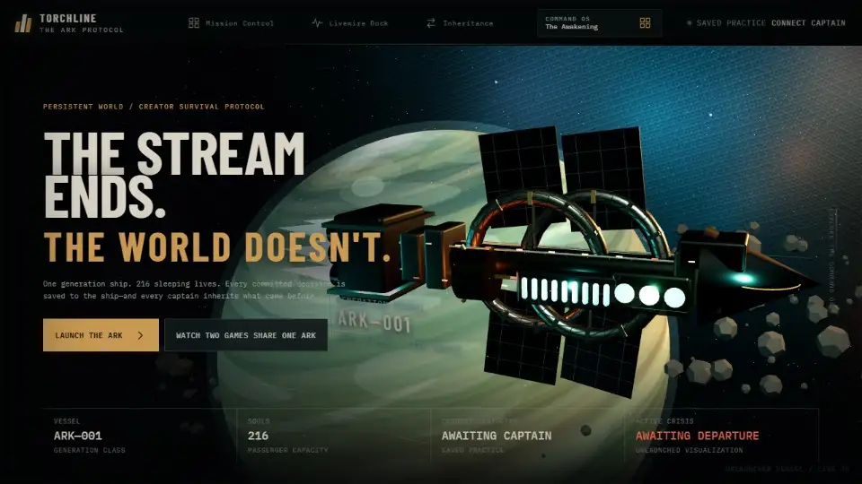
  </picture>
</a>

<h1>TORCHLINE · The Ark Protocol</h1>

<h3>The stream ends. The world doesn't.</h3>

<p>A persistent survival game for Twitch. Chat keeps one starship alive.<br>The games you already stream can scar or repair it. A raid hands that exact ship to the next community.</p>

<p>
<a href="https://torchline-demo.onrender.com"><b>▶&nbsp;Play it in your browser</b></a> &nbsp;·&nbsp;
<a href="https://youtu.be/mp-ckxsH4M4"><b>🎬&nbsp;Watch the video</b></a> &nbsp;·&nbsp;
<a href="#watch">Two games, one Ark</a> &nbsp;·&nbsp;
<a href="#chair">Take the captain's chair</a> &nbsp;·&nbsp;
<a href="#livewire">LIVEWIRE</a> &nbsp;·&nbsp;
<a href="#codex">Built with Codex</a> &nbsp;·&nbsp;
<a href="#proven">What is proven</a> &nbsp;·&nbsp;
<a href="#judges">Judge guide</a> &nbsp;·&nbsp;
<a href="docs/README.md">Docs</a>
</p>

<sub><a href="docs/releases/v0.1.0-preview.4.md">v0.1.0-preview.4</a> · Development preview · Codex x TwitchCon Hackathon · TypeScript · React Three Fiber · Fastify · PostgreSQL · Twitch EventSub</sub>

</div>

> [!IMPORTANT]
> **Built with OpenAI Codex.** Codex was TORCHLINE's lead engineer. Working in VS Code, it planned the product and its architecture, then built:
>
> - the deterministic game engine and PostgreSQL storage;
> - Twitch OAuth and signed EventSub;
> - the OBS overlay and the ten-screen interface from the Figma design;
> - LIVEWIRE.
>
> It wrote tests against real PostgreSQL as it went, from 26 to 30 October 2026.<br>
> **Codex session ID: `01a176fc-1e4a-7e83-b21e-1043aa17e8bc`** · [How Codex built it ↓](#codex)

> [!TIP]
> **Judges, start with the video (2:38): <https://youtu.be/mp-ckxsH4M4>** — real Twitch chat changing the Ark on a live broadcast, LIVEWIRE on live Twitch, and how Codex built it.<br>
> **Then play it yourself: <https://torchline-demo.onrender.com>** — no install, no Twitch account. Choose **Watch two games share one Ark → Autoplay to the handoff**: in about two minutes two communities in two different games change one Ark, using the real engine, database and custody rules with practice crews and a labelled simulated raid.<br>
> **Or test everything yourself, on your own machine and your own Twitch channel:** the [Judge guide ↓](#judges) needs nothing of mine.<br>
> <sub>Free hosting: after an idle spell the first visit can take about a minute, and the demo starts fresh each time it wakes. Prefer local? `docker compose up --build`, then http://localhost:3000.</sub>

## The idea in three moves

<table>
<tr>
<th width="33%">🧠 Chat solves the crisis</th>
<th width="33%">🎮 Your game counts</th>
<th width="33%">🔁 A raid moves the world</th>
</tr>
<tr>
<td><a href="assets/readme/mission-control.png"></a></td>
<td><a href="assets/readme/livewire-voxel.webp">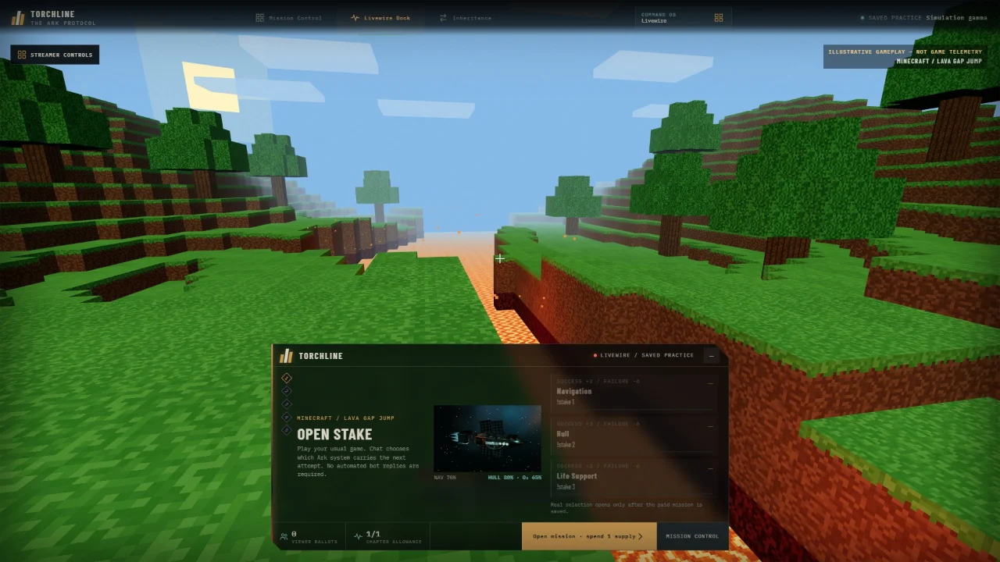</a></td>
<td><a href="assets/readme/relay-broadcast.png"></a></td>
</tr>
<tr>
<td>Viewers scan relays, route power and patch failing systems. Solving the problem changes the ship. Then the captain makes the hard call.</td>
<td>Before a risky attempt in the game you are already streaming, chat stakes one Ark system on it. The choice locks before you try; you confirm the result; the Ark keeps it.</td>
<td>At a chapter boundary, a Twitch raid hands the exact scarred ship, with its unpaid debts, to the next community. They see who caused every scar.</td>
</tr>
</table>

You can play all five chapters on one channel. **A raid moves the world; you don't need one to enjoy it.** The native raid handoff is built end to end, but a live raid between two broadcasters has not been verified yet. The Judge Arena rehearses it with labelled simulated proof.

<a id="watch"></a>

## 🎬 Watch two games share one Ark

<a href="https://youtu.be/mp-ckxsH4M4?t=71">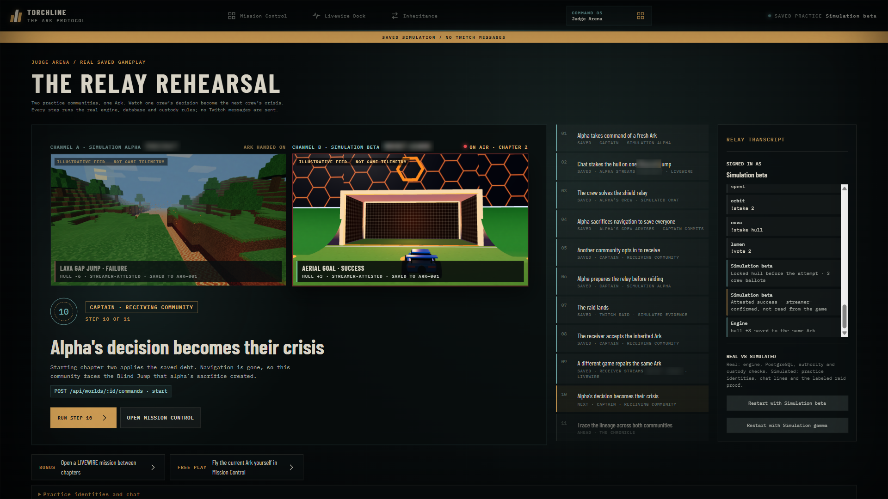</a>

<sub>This is the Judge Arena, captured from the app in saved practice; select the image to watch it run in the video. In channel A, a LIVEWIRE lava jump fails and the hull loses 6. After the handoff, channel B's aerial goal repairs the same hull by 3. Both results are scripted practice attestations, saved to the same Ark. The feeds are illustrations, not game telemetry, and the raid proof is simulated and labelled.</sub>

<details>
<summary><b>The eleven steps of the relay rehearsal</b>: every one calls the same API the dashboard uses</summary>
<br>

1. **Alpha takes command** of a fresh Ark: 216 passengers, five chapters.
2. **Chat stakes the hull on one jump.** Three crew ballots lock the hull before the attempt. The practice captain confirms the scripted failure, and the hull loses 6.
3. **The crew solves the shield relay** through practice chat. It is the same parser Twitch chat uses.
4. **Alpha sacrifices navigation.** Everyone survives, but a blind jump is now owed.
5. **Another community opts in** to receive an Ark.
6. **Alpha prepares the relay** before raiding.
7. **The raid lands.** The raid proof here is simulated and labelled; a live world refuses it.
8. **The receiver accepts** the inherited Ark, then reads the dossier.
9. **A different game repairs the same Ark.** The receiver's aerial goal adds 3 hull.
10. **Alpha's decision becomes their crisis.** Chapter two starts with the blind jump. Alpha's crew repaired the shields, so it costs no hull.
11. **Trace the lineage across both communities** in the Chronicle.

**Autoplay** stops at step 9, so a person reads the dossier before the receiver acts. Regression test: [`tests/browser/relay-rehearsal.spec.ts`](tests/browser/relay-rehearsal.spec.ts).

</details>

### How one Ark travels between streams

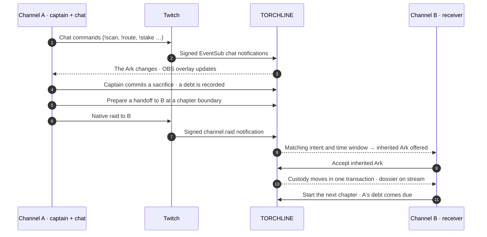

<sub>The live raid path is implemented end to end, but no native raid between two broadcasters has been verified yet ([what is proven](#proven)). A prepared intent, Twitch's signed notification and the receiver's consent must all agree. Chat, screenshots and simulator events can never move a live world.</sub>

<a id="chair"></a>

## 🪑 Take the captain's chair

> **Chapter 1 · Radiation Storm.** ARK-001 carries 216 sleepers. A radiation storm hits before your crew has finished the shield relay. You are the captain, so open a card to commit.<br>
> **Starting ship:** 216 passengers · hull 70 · power 60 · oxygen 65 · navigation 70 · supplies 50

<details>
<summary><b>🅰 Sacrifice navigation</b>: save every passenger</summary>
<br>

| Passengers | Hull | Power | Oxygen |    Navigation     | Supplies |
| :--------: | :--: | :---: | :----: | :---------------: | :------: |
|  **216**   |  65  |  50   |   65   | **0 · destroyed** |    50    |

**Debt created:** a blind jump, due in chapter 2.

**Chapter 2 · Blind Jump.** The debt lands. The shields were never repaired, so the jump costs hull: 65 → 55. With navigation gone, you choose again:

<details>
<summary>Rebuild navigation</summary>
<br>

| Passengers | Hull | Power  | Oxygen | Navigation | Supplies |
| :--------: | :--: | :----: | :----: | :--------: | :------: |
|    216     |  55  | **35** |   65   |   **60**   |  **25**  |

Navigation comes back, but it costs power and supplies, plus **a new debt: a supply debt due in chapter 4.** Repairs are never free.

</details>

<details>
<summary>Fly the debris field manually</summary>
<br>

| Passengers |  Hull  | Power | Oxygen |  Navigation   | Supplies |
| :--------: | :----: | :---: | :----: | :-----------: | :------: |
|    216     | **30** |  50   | **55** | 0 · destroyed |    50    |

No new debt, but nearly half the remaining hull is gone.

</details>

> 💡 If chat had solved the shield relay first, this blind jump would have cost no hull. That is exactly what happens in the Judge Arena.

</details>

<details>
<summary><b>🅱 Seal the rear habitat</b>: keep navigation, lose 48 people</summary>
<br>

| Passengers | Hull | Power | Oxygen | Navigation | Supplies |
| :--------: | :--: | :---: | :----: | :--------: | :------: |
|  **168**   |  60  |  60   |   60   |     70     |    50    |

The sealed habitat stays visible on the ship and in the record.

**Chapter 2 · Safe Corridor.** Navigation survived, so there is a charted way through. You choose again:

<details>
<summary>Search the derelict</summary>
<br>

| Passengers |  Hull  | Power | Oxygen | Navigation | Supplies |
| :--------: | :----: | :---: | :----: | :--------: | :------: |
|    168     | **45** |  55   |   60   |     70     |  **65**  |

The search finds 15 supplies, at a cost of 15 hull and 5 power.

</details>

<details>
<summary>Take the safe corridor</summary>
<br>

| Passengers | Hull | Power  | Oxygen | Navigation | Supplies |
| :--------: | :--: | :----: | :----: | :--------: | :------: |
|    168     |  60  | **55** |   60   |     70     |    50    |

The hull holds and only five power is spent.

</details>

</details>

<details>
<summary><b>One viewer. Four oxygen. A different ending.</b></summary>
<br>

Follow the same planned captain's route twice, with no viewer help except one person:

- **Without** a chapter-three life-support repair, oxygen runs out and the voyage ends as a wreck in chapter 5.
- **With** one viewer's `!scan A` and `!patch A` in chapter 3, **156 passengers reach the surface with four oxygen left.** They land, though not as a viable colony.

Open the [flight recorder](assets/readme/flight-log.csv) and search for **patch**.

</details>

<sub>Every number above comes from the real engine, and replay checks it ([proof](assets/readme/proof.json)). `pnpm readme:proof` regenerates the file, and CI fails if the proof drifts from the rules.</sub>

<a id="crew"></a>

## 🧠 Your chat is the crew

<a href="assets/readme/mission-control.png"></a>

Voting is only one part of the job. A correct shared solution changes resources, ship condition and the choices that come later.

| Type in chat                                 | What it does                                             |
| -------------------------------------------- | -------------------------------------------------------- |
| <kbd>!scan A</kbd>                           | Reveals a relay clue that the crew shares                |
| <kbd>!route A B C</kbd>                      | Submits a power route; the right one repairs the shields |
| <kbd>!patch A</kbd>                          | Patches failing equipment                                |
| <kbd>!inspect engine</kbd>                   | Investigates an area (engine, cargo or life support)     |
| <kbd>!allocate hull 3 oxygen 2</kbd>         | Splits the crew's repair effort                          |
| <kbd>!vote 1</kbd>                           | Advises the captain; only the captain commits            |
| <kbd>!stake 2</kbd> · <kbd>!stake hull</kbd> | Picks the system at risk in a LIVEWIRE mission           |

Every chat message reaches TORCHLINE as a signed EventSub notification. It is deduplicated and applied at most once, and the overlay shows the result.

<a id="livewire"></a>

## 🎮 LIVEWIRE: your next attempt matters

<a href="https://youtu.be/mp-ckxsH4M4?t=48">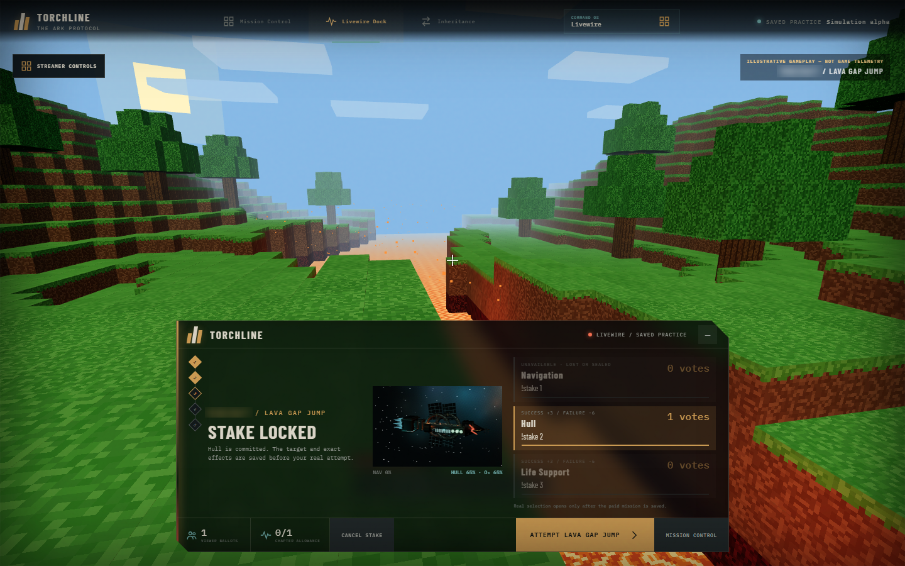</a>

Keep playing your usual game. Before a difficult jump, an aerial or a boss attempt, open one mission:

1. Chat chooses which Ark system is at risk.
2. The commitment locks before you try.
3. You confirm what happened.
4. One small repair or scar is written to the real saved ship, exactly once.

<table>
<tr>
<td width="33%"></td>
<td width="33%">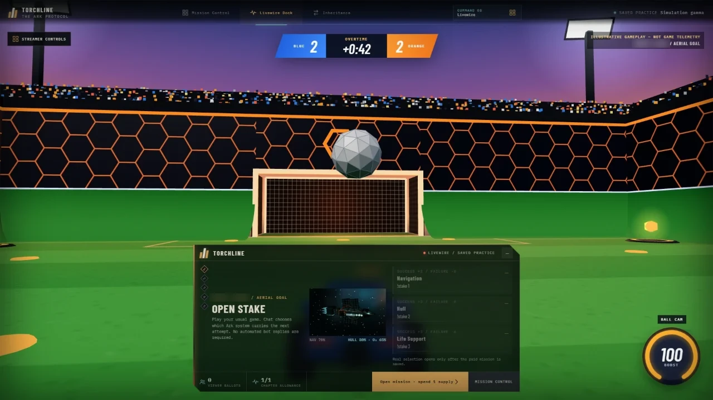</td>
<td width="33%">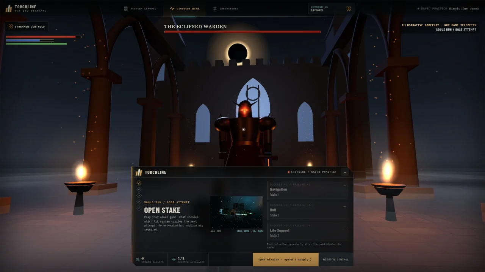</td>
</tr>
<tr>
<td align="center"><b>Voxel Survival</b> preset · lava gap jump</td>
<td align="center"><b>Car Soccer</b> preset · aerial goal</td>
<td align="center"><b>Souls Run</b> preset · boss attempt</td>
</tr>
</table>

The preset only picks the illustrated scene. The streamer names the game they are really playing.

| Rule         | Value                                                                                                                                                 |
| ------------ | ----------------------------------------------------------------------------------------------------------------------------------------------------- |
| When         | At a chapter boundary, once per boundary (five per voyage at most)                                                                                    |
| Cost         | 1 supply, never refunded                                                                                                                              |
| Chat picks   | Navigation, hull or life support with <kbd>!stake 1</kbd>, <kbd>!stake 2</kbd> or <kbd>!stake 3</kbd>                                                 |
| Success      | Up to **+3** to that system                                                                                                                           |
| Failure      | Up to **−6**, never below 1                                                                                                                           |
| Lasting mark | The system is also marked repaired (win) or damaged (loss), and that can matter later. For example, damaged life support leaks 15 oxygen in chapter 4 |
| Never        | Revives a destroyed system, reads game data or decides the result                                                                                     |
| Evidence     | Every result is labelled **streamer-attested**                                                                                                        |

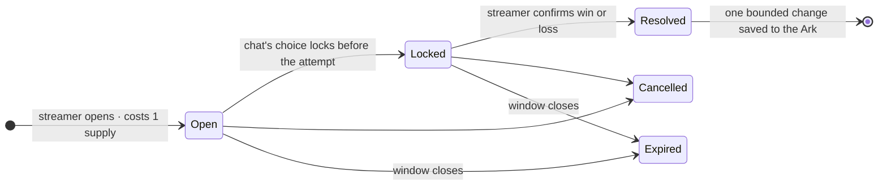

[Exact rules](docs/product/livewire-v0.md) · [Design decision](docs/decisions/0037-cross-game-livewire-relay.md)

<a id="relay"></a>

## 🔁 The relay: someone else's decision becomes your crisis

<table>
<tr>
<td width="44%"><a href="assets/readme/dossier.png">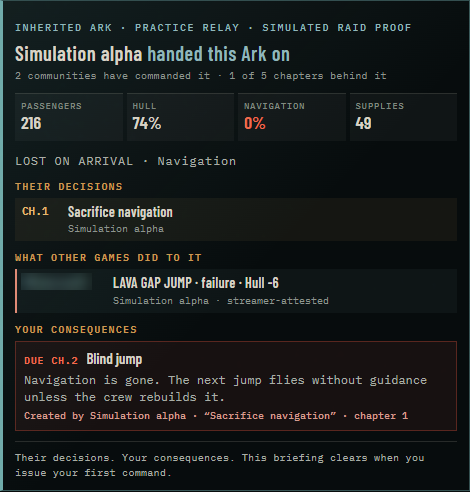</a></td>
<td>

When a captain hands the Ark on, the receiving stream sees an **inheritance dossier**:

- who handed it over;
- every decision aboard and the community that made it;
- **what other games did to the hull**;
- the systems already lost;
- each debt still waiting, linked to the decision that created it.

Starting the next chapter makes the debt real. The new audience inherits a problem it can trace to people it has never met.

Custody moves only when three things agree: a prepared handoff intent, Twitch's signed `channel.raid` notification, and the receiver's explicit acceptance. All three commit in one database transaction.

</td>
</tr>
</table>

<a id="chronicle"></a>

## 📜 The Chronicle remembers, and lets you check

<a href="assets/readme/lineage.png"></a>

Rows are communities, columns are chapters. Arrows are saved cause links, such as a sacrifice that became a crisis or a repair that prevented a leak. Dotted markers are custody changes.

<table>
<tr>
<th width="50%">What if they had chosen differently?</th>
<th width="50%">Verify this record</th>
</tr>
<tr>
<td align="center">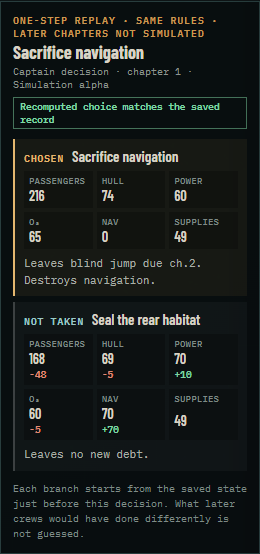</td>
<td align="center">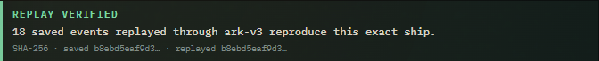</td>
</tr>
<tr>
<td>Select any decision or attested mission. The server rebuilds the world exactly as it was before that event and applies every option with the same rules, actor and timestamp. It says <i>"matches the saved record"</i> only when the recomputed choice equals the stored event. Later chapters are never guessed.</td>
<td>Replays the whole saved log from the start through its pinned rules version, then compares SHA-256 digests of the replayed ship and the saved ship. In tests, an altered saved state is caught. This checks that the stored history reproduces the stored ship. It is not a signature, and it cannot prove the inputs were genuine Twitch chat.</td>
</tr>
</table>

A captain can also publish a revocable, read-only **public Chronicle link**, so the community that handed an Ark on can keep following it, and so can judges.

<details>
<summary><b>Season finale and season record</b></summary>
<br>

<a href="assets/readme/season-finale.png"></a>

<a href="assets/readme/season-record.png"></a>

Captured from the app in saved practice. Those relays used labelled simulated raid evidence.

</details>

<a id="codex"></a>

## 🤖 Built with OpenAI Codex

<table>
<tr><td><b>Codex session ID</b></td><td><code>01a176fc-1e4a-7e83-b21e-1043aa17e8bc</code></td></tr>
<tr><td><b>Where</b></td><td>Codex in VS Code, mostly in one continuous thread, 26–30 October 2026</td></tr>
<tr><td><b>Standing brief</b></td><td><a href="AGENTS.md"><code>AGENTS.md</code></a>, the operating contract Codex worked under</td></tr>
<tr><td><b>In the video</b></td><td><a href="https://youtu.be/mp-ckxsH4M4?t=122">From 2:02: the Codex thread, its brief and its commits</a></td></tr>
</table>

**Codex by the numbers**, one thread, 26–30 October:

| Tasks completed | Tool executions | File patches | Test runs | Commits | Output tokens |
| :-------------: | :-------------: | :----------: | :-------: | :-----: | :-----------: |
|     **45**      |    **1,795**    |   **560**    |  **202**  | **73**  |  **2.18 M**   |

<sub>Counted from the session's own log (`rollout-2026-10-26T12-23-16-01a176fc-….jsonl`): completed tasks, executed tool calls, applied patches, Vitest and Playwright runs, and non-merge commits on `main` in that window. Seventeen context compactions kept it one continuous thread. Counts only; no prompt or output text is published.</sub>

Codex built TORCHLINE as its lead engineer. I gave it a standing contract instead of one-off prompts. These lines from `AGENTS.md` shaped every task:

> - Pure deterministic engine; explicit versioned content and events; no network, clock, or random calls inside transitions.
> - PostgreSQL is authoritative. Custody, state, domain events, and publish intents commit atomically.
> - Never treat a chat message, browser notification, simulator event, or screenshot as verified native raid proof.
> - Mark implemented versus simulated versus unverified behavior explicitly.

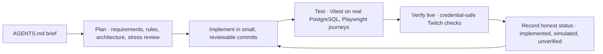

| Day             | What Codex built                                                                                                                                                                                                                                                                                                |
| --------------- | --------------------------------------------------------------------------------------------------------------------------------------------------------------------------------------------------------------------------------------------------------------------------------------------------------------- |
| **26&nbsp;Oct** | The product plan, requirements, architecture and decision stress review. Then the persistent-Ark engine and the Twitch foundation: OAuth, signed EventSub webhooks and bot replies that never block gameplay                                                                                                    |
| **27&nbsp;Oct** | Episodes and pacing, viewer allocation, Twitch recovery, versioned cooperation rules and a complete history. Also the cinematic launch, the Ark geometry, and the command deck and OBS views                                                                                                                    |
| **28&nbsp;Oct** | Cinematic encounters, encrypted backups with verified restores, credential-safe live HTTPS, a restricted container image checked in CI, and live acceptance tooling                                                                                                                                             |
| **29&nbsp;Oct** | An independent adversarial QA pass, chat-delivery diagnosis and recovery, overlays that reconnect after lost chat, and requirement and authority audits. Released v0.1.0-preview.1                                                                                                                              |
| **30&nbsp;Oct** | The final Figma design across all ten screens, and LIVEWIRE: finite versioned missions, signed chat selection, atomic Ark consequences and a transparent OBS dock. Released v0.1.0-preview.2. Then stale-assignment protection, a private-path guard and property-based balance witnesses, committed that night |

Codex verified live behaviour honestly, too. It found that Twitch accepted the bot's replies but viewers never saw them. So acknowledgements moved to the overlay, and replies stayed paused until 2 November, when making the bot a channel moderator fixed delivery.

### The rest of the team

|                                 | Role                                                                                                                                                                                                                                                                                                                                                                                                                                                                       |
| ------------------------------- | -------------------------------------------------------------------------------------------------------------------------------------------------------------------------------------------------------------------------------------------------------------------------------------------------------------------------------------------------------------------------------------------------------------------------------------------------------------------------- |
| **OpenAI Codex**                | Lead engineer: everything above, in session `01a176fc-1e4a-7e83-b21e-1043aa17e8bc`                                                                                                                                                                                                                                                                                                                                                                                         |
| **Claude Code**                 | Reviewer and checker. It audited the build against the hackathon rules and the tests, and verified the live evidence. On 1 November it also built the final layer: the Judge Arena relay rehearsal, the inheritance dossier, lineage and public Chronicle links, _What if?_ and _Verify this record_, and the Docker preview. It also integrated the per-game LIVEWIRE scenes from Figma. On 2 November it fixed native raid readiness and set up the hosted practice demo |
| **Claude Design** and **Figma** | UI/UX. Claude Design shaped the first command-deck and OBS layouts; Figma holds the final ten-screen design and the LIVEWIRE game scenes                                                                                                                                                                                                                                                                                                                                   |
| **The creator**                 | The vision, the game design direction, the Figma design and every product decision                                                                                                                                                                                                                                                                                                                                                                                         |

<a id="architecture"></a>

## 🧱 Architecture

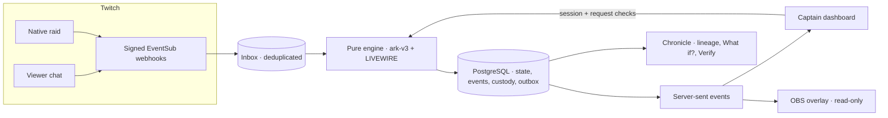

<details>
<summary><b>Invariants the code enforces</b></summary>
<br>

- **Deterministic rules.** A transition never reads the clock, the network or randomness, so every saved world replays exactly. Rules are versioned (`ark-v3`, LIVEWIRE `v0`), and each world pins the version it started with.
- **One source of truth.** State, domain events, custody and publish intents commit in one PostgreSQL transaction, with optimistic versions and idempotency keys.
- **At-least-once Twitch.** Deliveries are signature-checked, deduplicated and processed through a durable inbox. Nothing is claimed to be exactly-once.
- **Authority.** Every mutation is authorized by the server session and current custody. Overlays are read-only links that can be rotated.
- **Practice and live are separate.** Simulation and live worlds are separated both visibly and technically. Practice raid proof is refused by live worlds.
- **No pretend proof.** Animations, bot replies and illustrated game feeds never decide outcomes.

[System design](docs/architecture/system-design.md) · [Data and contracts](docs/architecture/data-and-contracts.md) · [All decisions (ADRs)](docs/decisions/README.md)

</details>

<a id="proven"></a>

## ✅ What is proven

| Area                                                      | Status | Evidence                                                                                                                                                                                                                                                                                                                        |
| --------------------------------------------------------- | :----: | ------------------------------------------------------------------------------------------------------------------------------------------------------------------------------------------------------------------------------------------------------------------------------------------------------------------------------- |
| Engine, storage, replay                                   |   ✅   | 164 Vitest tests in 43 files on real PostgreSQL; every saved world replays to its stored state                                                                                                                                                                                                                                  |
| Judge Arena relay, dossier, lineage, _What if?_, _Verify_ |   ✅   | Playwright journey through the full two-game relay; the raid proof is simulated and labelled                                                                                                                                                                                                                                    |
| LIVEWIRE missions                                         |   ✅   | Locked ballots, one attested consequence, reload and history, all in saved practice                                                                                                                                                                                                                                             |
| Hosted practice demo                                      |   ✅   | [torchline-demo.onrender.com](https://torchline-demo.onrender.com): the production server in simulation mode ([ADR 0039](docs/decisions/0039-hosted-practice-demo.md)). CI builds and plays its image on every push; on 2 Nov the Judge Arena relay ran end to end on the hosted copy                                           |
| One-command preview                                       |   ✅   | CI starts `docker compose` on every push and plays the first judge steps ([`smoke-compose.mjs`](scripts/smoke-compose.mjs))                                                                                                                                                                                                     |
| Your own live instance                                    |   ✅   | [`compose.live.yaml`](compose.live.yaml) runs the live server with your Twitch application and your free ngrok address ([Judge guide](#judge-twitch)). CI starts it in live mode on every push and checks that Twitch sign-in goes to your application with the exact redirect; the same server ran live on my channel on 2 Nov |
| OBS views                                                 |   ✅   | Native OBS render, refresh and link rotation verified in saved practice ([report](docs/reports/2026-10-30-final-frontend.md))                                                                                                                                                                                                   |
| Real Twitch chat → live Ark                               |   ✅   | On 30 Oct, three genuine viewer commands arrived as signed EventSub notifications and were saved as gameplay on a live Ark ([status](docs/planning/implementation-status.md))                                                                                                                                                   |
| Overlay updating from live chat, on video                 |   ✅   | On 2 Nov, recorded from the public stream page: `!scan A`, `!scan B`, `!scan C` and `!route S A C T` arrived as signed EventSub notifications, the OBS overlay on the live stream updated without a refresh, and hull rose 70 → 85 ([watch at 0:16](https://youtu.be/mp-ckxsH4M4?t=16))                                         |
| Raid handoff (custody transfer)                           |   ✅   | Implemented end to end and tested against Twitch's signed `channel.raid` payload shape, including the empty unused-direction field Twitch echoes (handled since 2 Nov). The Judge Arena runs it with labelled simulated evidence. A live run between two broadcasters needs a second consenting streamer and is next            |
| LIVEWIRE on live Twitch                                   |   ✅   | On 2 Nov, during the broadcast: a mission opened, a signed `!stake 2` from chat chose hull, the stake locked before the attempt, and the streamer-attested success saved +3 hull. The read-only verifier reports 1 signed ballot and 1 attested effect ([watch at 0:48](https://youtu.be/mp-ckxsH4M4?t=48))                     |
| Bot replies                                               |   ✅   | Twitch was filtering the new bot account. After I made it a channel moderator ([ADR 0040](docs/decisions/0040-bot-moderator-role.md)), an anonymous viewer received its messages, and `!status` was answered in the live chat on 2 Nov ([watch at 0:40](https://youtu.be/mp-ckxsH4M4?t=40)). Gameplay never depends on replies  |
| Permanent live hosting                                    |   ⏳   | The practice demo is hosted (above). My live Twitch play runs on my own computer through a secure tunnel while I stream, and you can run your own the same way ([Judge guide](#judge-twitch)); viewers need nothing but Twitch chat. An always-on live host is next                                                             |

<sub>✅ implemented and verified as described · ⏳ open · ⚠️ known limitation. This is a development preview, not a production service. [Implementation status](docs/planning/implementation-status.md) · [Critical audit](docs/reviews/2026-10-29-comprehensive-audit.md)</sub>

<a id="judges"></a>

<a id="play"></a>

<a id="run-it"></a>

## 🧑‍⚖️ Judge guide: test everything yourself

Nothing below depends on my computer or my accounts. Each path stands alone, from watching to running TORCHLINE on your own Twitch channel.

| Path                                                    | Time     | You need                                                  | What you can check                                                                                 |
| ------------------------------------------------------- | -------- | --------------------------------------------------------- | -------------------------------------------------------------------------------------------------- |
| [1 · Watch the video](#judge-watch)                     | 2:38     | A browser                                                 | The real broadcast, LIVEWIRE on live Twitch and how Codex built it                                 |
| [2 · Play the hosted demo](#judge-hosted)               | 2–10 min | A browser                                                 | The Judge Arena relay, LIVEWIRE, the Chronicle, _What if?_, _Verify this record_ and the OBS views |
| [3 · Run it with Docker](#judge-docker)                 | ~5 min   | Docker and Git                                            | The same practice game, served from your machine                                                   |
| [4 · Play it on your own Twitch channel](#judge-twitch) | ~25 min  | Docker, Git, two Twitch accounts and a free ngrok account | Your real chat changing your Ark and overlay, LIVEWIRE, bot replies and, optionally, a raid        |
| [5 · Check the engineering](#judge-tests)               | 1–15 min | A browser, or Node 24 and PostgreSQL 17                   | 164 Vitest tests on real PostgreSQL and 25 Playwright journeys                                     |

<a id="judge-watch"></a>

### 1 · Watch the video

<https://youtu.be/mp-ckxsH4M4>: live Twitch from [0:16](https://youtu.be/mp-ckxsH4M4?t=16), LIVEWIRE live from [0:48](https://youtu.be/mp-ckxsH4M4?t=48), the Judge Arena from [1:11](https://youtu.be/mp-ckxsH4M4?t=71) and Codex from [2:02](https://youtu.be/mp-ckxsH4M4?t=122).

<a id="judge-hosted"></a>

### 2 · Play the hosted demo

<https://torchline-demo.onrender.com> is a disposable practice copy with LIVEWIRE on: practice sign-in and no Twitch account ([ADR 0039](docs/decisions/0039-hosted-practice-demo.md)). After an idle spell the first visit can take about a minute, and it starts fresh whenever the free host wakes it.

1. Choose **WATCH TWO GAMES SHARE ONE ARK**, then **AUTOPLAY TO THE HANDOFF**. Autoplay stops at step 9 so you read the inheritance dossier before the receiver acts.
2. Run step 9 (a different game repairs the same hull) and step 10 (the inherited debt arrives).
3. Open the Chronicle, then try **What if?** and **Verify this record**.
4. For free play, choose **LAUNCH THE ARK** and use **Command OS** for all ten destinations: send practice chat such as `!scan A` from Mission Control, open a mission in **03 Livewire** at a chapter boundary, and see the OBS views in **06 Broadcast**.

<a id="judge-docker"></a>

### 3 · Run it with Docker

```sh
git clone https://github.com/vighriday/TORCHLINE.git
cd TORCHLINE
docker compose up --build    # the first build takes a few minutes; then open http://localhost:3000
```

The same saved practice as the hosted demo, with LIVEWIRE on, served only to your machine from a fresh database on every start. No Twitch account is involved. Stop it with <kbd>Ctrl</kbd>+<kbd>C</kbd>, then `docker compose down`. CI runs this exact command on every push and plays the first judge steps ([`smoke-compose.mjs`](scripts/smoke-compose.mjs)).

<details>
<summary><b>Without Docker: Node 24, pnpm 12.4.2 and PostgreSQL 17</b></summary>
<br>

```powershell
pnpm install --frozen-lockfile
pnpm db:up        # private local cluster and ignored .env (saved practice, LIVEWIRE on)
pnpm db:migrate
pnpm build
pnpm start        # http://localhost:3000
```

`pnpm db:up` expects the PostgreSQL 17 binaries; the [development guide](docs/operations/development.md) explains the options.

</details>

<a id="judge-twitch"></a>

### 4 · Play it on your own Twitch channel

[`compose.live.yaml`](compose.live.yaml) runs the live server, its PostgreSQL and an ngrok tunnel on your machine with **your** Twitch application. Twitch reaches it through your own free ngrok address, and nothing touches my machine or accounts. Chat play works while your channel is offline; only a raid needs you to be live.

**You need:**

- Docker Desktop (or Docker Engine with Compose v2) and Git.
- Your Twitch account with two-factor authentication on, which Twitch requires for its developer console.
- A second Twitch account for the bot. To reuse your email, turn on **Enable additional account creation** under Twitch → Settings → Security and Privacy.
- A free [ngrok account](https://dashboard.ngrok.com/signup). Each account includes one fixed dev domain, such as `your-name.ngrok-free.dev`.

**Set up once, about 15 minutes:**

1. **Your address.** In the ngrok dashboard, copy your authtoken and your dev domain (under **Domains**).
2. **Your Twitch application.** At <https://dev.twitch.tv/console/apps>, choose **Register Your Application**:

   | Field               | Value                                                   |
   | ------------------- | ------------------------------------------------------- |
   | Name                | Anything unique, such as `TORCHLINE-yourname`           |
   | OAuth Redirect URLs | `https://your-name.ngrok-free.dev/auth/twitch/callback` |
   | Category            | Game Integration                                        |
   | Client Type         | Confidential                                            |

   Then choose **Manage**, copy the **Client ID**, choose **New Secret** and copy the **Client Secret**.

3. **Your settings.** In the cloned repository, copy the template:

   ```sh
   cp .env.live.example .env.live    # PowerShell: Copy-Item .env.live.example .env.live
   ```

   Fill in `NGROK_AUTHTOKEN`, `PUBLIC_BASE_URL` (`https://` and your dev domain, with no trailing slash), `TWITCH_CLIENT_ID` and `TWITCH_CLIENT_SECRET`. Then print four fresh private keys and paste them over the placeholders:

   ```sh
   docker run --rm node:24-alpine node -e "for (const k of ['SESSION_SECRET','TOKEN_ENCRYPTION_KEY','BOT_SETUP_SECRET','EVENTSUB_SECRET']) console.log(k + '=' + require('crypto').randomBytes(32).toString('hex'))"
   ```

   `.env.live` is ignored by Git and never enters the Docker image.

4. **Start it:**

   ```sh
   docker compose --env-file .env.live -f compose.live.yaml up -d --build
   ```

   `https://your-name.ngrok-free.dev/health/ready` should show `{"ok":true}`. On ngrok's free plan each browser sees a one-time "You are about to visit" page; choose **Visit Site**.

5. **Connect your channel.** Open your address in your usual browser, signed in to Twitch as yourself. Choose **CONNECT CREATOR WITH TWITCH** and approve.
6. **Authorize your bot.** In a private window, sign in to twitch.tv as the bot account and open your address. Expand **Dedicated bot setup · operator access**, paste `BOT_SETUP_SECRET` from `.env.live` into **Bot setup secret**, choose **Authorize dedicated bot** and approve.
7. **Connect Twitch events.** Back in your usual window, refresh, open **Command OS → 06 Broadcast** and choose **Check / repair Twitch subscriptions**. The chat, stream-online and stream-offline subscriptions should be confirmed; Twitch calls your address to confirm each one.

**Play, about 10 minutes:**

8. **Your chat is the crew.** Choose **LAUNCH THE ARK** and **Start chapter 1** in Mission Control. In your channel's chat (**Open Twitch chat**, or `twitch.tv/popout/YOURNAME/chat`) send `!scan A`, `!scan B` and `!scan C`, then the route the clues reveal (chapter 1 accepts `!route S A C T`). The ship changes, the change is saved, and **chat actions applied** rises in 06 Broadcast. Any viewer account works the same way.
9. **Your overlay.** In 06 Broadcast choose **Generate / rotate private OBS source**, then **COPY SOURCE**. Add it to OBS as a Browser Source (1920 × 1080) or open it in a new tab; it updates without a refresh. Keep that link private.
10. **LIVEWIRE.** At a chapter boundary, open **03 Livewire** and choose **Open mission · spend 1 supply**. Chat stakes a system with `!stake 2`. Choose **Lock commitment · start attempt**, make your attempt in any game, confirm the result and choose **WRITE CONSEQUENCE TO ARK**.
11. **Bot replies (optional).** Twitch filters brand-new bot accounts, so type `/mod YOURBOTNAME` in your chat ([ADR 0040](docs/decisions/0040-bot-moderator-role.md)), then send `!status`.
12. **A native raid (optional).** Connect a second broadcaster account at the same address from another browser profile, turn on **04 Relay → Accept incoming world offers** there and repair its subscriptions. With both channels live, choose **Prepare handoff** on the source at a chapter boundary, raid the receiver with Twitch's usual `/raid` command, then choose **Accept inherited Ark** on the receiver. This flow is implemented and tested against Twitch's signed `channel.raid` payload, but I have not yet run it between two live broadcasters.

**Stop or reset:** `docker compose --env-file .env.live -f compose.live.yaml down` keeps your Ark for next time; add `--volumes` to erase it. **Disconnect Twitch authorization** in 06 Broadcast removes TORCHLINE's access to your account.

<details>
<summary><b>If something goes wrong</b></summary>
<br>

| Symptom                             | Check                                                                                                           |
| ----------------------------------- | --------------------------------------------------------------------------------------------------------------- |
| `set … in .env.live`                | That value is still missing from `.env.live`                                                                    |
| Twitch says the redirect is invalid | The console's OAuth Redirect URL must be exactly `PUBLIC_BASE_URL` followed by `/auth/twitch/callback`          |
| Subscriptions stay unconfirmed      | `docker compose --env-file .env.live -f compose.live.yaml logs tunnel app`, and `/health/ready` on your address |
| Chat does nothing                   | An Ark in an open phase on your channel, the bot authorized and the subscriptions confirmed                     |
| OBS shows ngrok's notice            | Right-click the source → **Interact** → **Visit Site**, once                                                    |
| "Invalid state" after sign-in       | The one-use sign-in expired; start again from your address                                                      |

More detail: [Twitch setup](docs/operations/twitch-setup.md) and the [launch guide](docs/operations/owner-launch-guide.md).

</details>

**What has been verified:** the same server ran live on my channel on 2 November through an ngrok tunnel: chat changed the Ark and the overlay, LIVEWIRE saved a result and the bot replied. CI builds [`compose.live.yaml`](compose.live.yaml) on every push and checks that it starts in live mode and sends Twitch sign-in to your application with the exact redirect.

<a id="judge-tests"></a>

### 5 · Check the engineering

**Without installing anything:** every push runs the full suite on GitHub Actions: 164 Vitest tests on real PostgreSQL, 25 Playwright journeys, the Docker preview, the hosted demo image and the live setup above. Open the latest [Verify run](https://github.com/vighriday/TORCHLINE/actions/workflows/verify.yml) and read its log.

**On your machine,** with Node 24, pnpm 12.4.2 and PostgreSQL 17 (`pnpm db:up` creates a private cluster, or set `DATABASE_URL` in `.env` to any empty database):

```powershell
pnpm install --frozen-lockfile
pnpm db:up
pnpm build
pnpm test            # Vitest: engine, storage (real PostgreSQL), server, Twitch fixtures
pnpm exec playwright install chromium
pnpm test:browser    # Playwright journeys, including the full relay
pnpm format:check
pnpm check:repo      # private inputs excluded, local links valid
pnpm check:version   # versions, release notes and this README agree
pnpm readme:proof    # regenerate the engine proof behind this README
```

The [Verify workflow](.github/workflows/verify.yml) is the exact recipe CI uses, including its PostgreSQL 17 container.

<details>
<summary><b>Repository map</b></summary>
<br>

| Path                                       | What lives there                                                             |
| ------------------------------------------ | ---------------------------------------------------------------------------- |
| [`apps/server`](apps/server)               | Fastify API, Twitch webhooks and OAuth, server-sent event feeds              |
| [`apps/web`](apps/web)                     | React 19 + React Three Fiber client: ten screens, OBS views, LIVEWIRE scenes |
| [`packages/engine`](packages/engine)       | Pure deterministic rules (`ark-v3`) and the LIVEWIRE extension               |
| [`packages/storage`](packages/storage)     | PostgreSQL authority, migrations, replay, _What if?_ and verification        |
| [`packages/contracts`](packages/contracts) | Zod schemas shared by every package                                          |
| [`packages/twitch`](packages/twitch)       | OAuth, EventSub signature checks, chat parsing, bot delivery                 |
| [`tests`](tests)                           | Vitest suites on real PostgreSQL and Playwright journeys                     |
| [`docs`](docs/README.md)                   | Product, architecture, operations, decisions and dated reports               |

</details>

---

<div align="center">

<sub>
<a href="docs/product/requirements.md">Requirements</a> ·
<a href="docs/product/game-design.md">Game design</a> ·
<a href="docs/architecture/system-design.md">Architecture</a> ·
<a href="docs/decisions/README.md">Decisions</a> ·
<a href="docs/research/twitch-integration.md">Twitch research</a> ·
<a href="CHANGELOG.md">Changelog</a> ·
<a href="SECURITY.md">Security</a> ·
<a href="assets/design-provenance.md">Asset provenance</a>
</sub>

<br><br>

<sub>TORCHLINE is not affiliated with or endorsed by Twitch or OpenAI. Its game scenes are original illustrations and never read game data.</sub>

</div>
