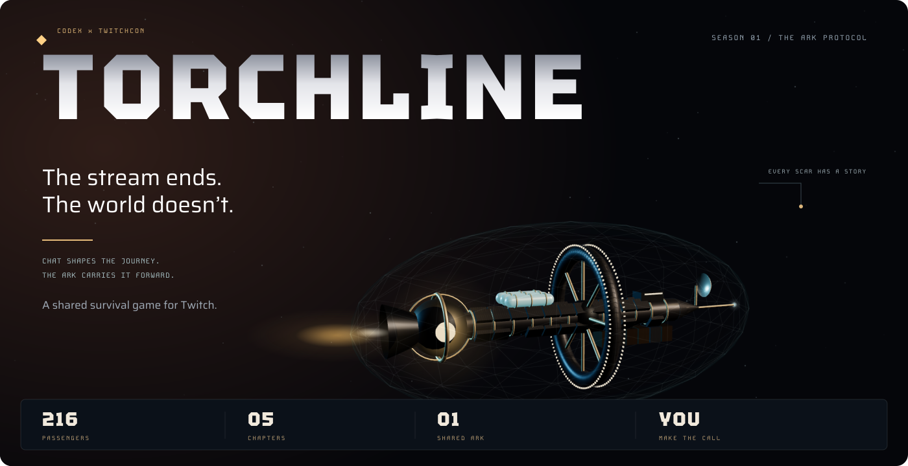
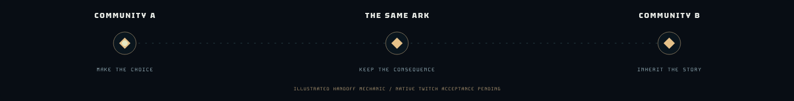
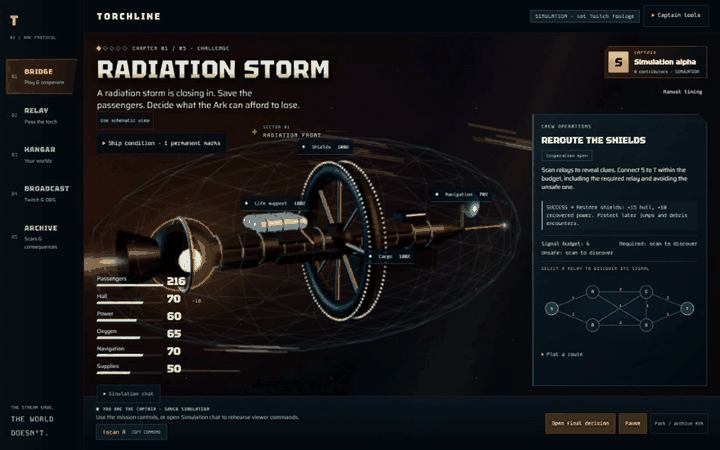
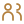
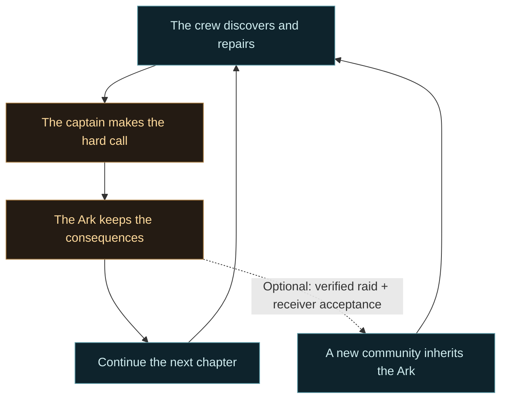
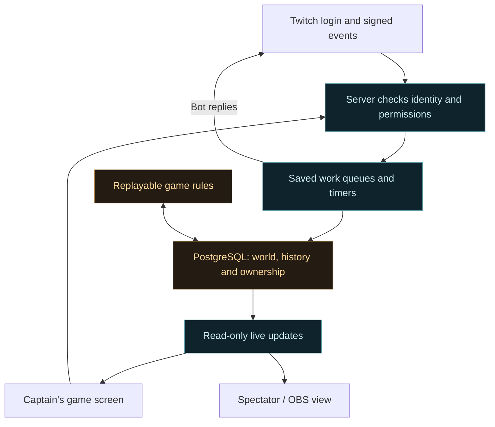

<p align="center">
  
</p>

<p align="center"><strong>One community saves the passengers. The next inherits the price.</strong></p>

<p align="center">
  <a href="#make-the-first-choice">Make a choice</a> ·
  <a href="assets/readme/ark.stl">Rotate the Ark in 3D</a> ·
  <a href="#see-it-in-motion">See gameplay</a> ·
  <a href="#try-torchline">Try it</a> ·
  <a href="#behind-the-game">Behind the game</a>
</p>

<p align="center"><sub>Built with Codex for the Codex x TwitchCon Hackathon · Season 01: The Ark Protocol</sub></p>

<p align="center"><a href="docs/releases/v0.1.0-preview.1.md">v0.1.0-preview.1</a> · Development preview · <a href="https://github.com/vighriday/TORCHLINE/releases">Releases</a></p>

# Your chat leaves a world behind

**TORCHLINE is a shared survival game for Twitch.** Your community is aboard a colony ship carrying 216 people. Together, you uncover clues, solve emergencies and repair what you can. Your streamer makes the hard calls.

Save the passengers by burning the navigation system? The next chapter begins with a ship that cannot find its way. Those choices stay with you.

You can play the whole journey on one channel. Or pass the same Ark to another streamer through a real Twitch raid. **They inherit your people, your repairs and your mistakes.**

<picture>
  <source media="(prefers-reduced-motion: reduce)" srcset="assets/readme/world-trace-still.svg">
  
</picture>

> **Where we are:** the full journey works in a saved practice game. Twitch sign-in, event connections and the public game screen have been checked. Real chat gameplay, visible bot replies, OBS and the two-streamer raid test still need live confirmation. [Evidence and next steps](#what-works-today).

## Make the first choice

A radiation storm is closing in. All **216 passengers** are aboard. Your crew has not solved the shield challenge. What do you save?

<details>
<summary><strong>◇ Sacrifice navigation. Save everyone aboard.</strong></summary>

**216 people survive. Navigation falls to zero.**

You burn the navigation array to protect the passengers. The next chapter becomes a blind jump: rebuild guidance or fly manually. The destroyed array stays on the ship, even if another captain takes over.

After the choice: **65 hull · 50 power · 65 oxygen · 0 navigation.** No challenge reward or repair allocation is included in this example.

</details>

<details>
<summary><strong>◇ Seal the rear habitat. Keep the ship’s guidance.</strong></summary>

**168 people survive. Forty-eight are lost.**

You isolate the exposed habitat and keep navigation working. The next chapter offers a safer route. The sealed habitat and the lives lost remain part of the ship’s history.

After the choice: **60 hull · 60 power · 60 oxygen · 70 navigation.** No challenge reward or repair allocation is included in this example.

</details>

These are actual results from the current game rules. [Check the generated results](assets/readme/proof.json).

### One viewer can change the ending

We played the same planned captain’s route twice. The difference was one viewer discovering and patching a life-support fault in chapter 3.

| Without the repair | With the repair |
| --- | --- |
| **Oxygen runs out. The Ark is lost.** | **Four oxygen remain. 156 people reach the surface.** |
| The ship fails before the final landing choice. | The final burn becomes possible. Supplies are too low to establish a colony. |

A small repair changes the future you can reach. It does not guarantee a perfect ending.

<details>
<summary><strong>Follow that one repair through the flight recorder</strong></summary>

[Open the flight log](assets/readme/flight-log.csv) and search **patch** in GitHub’s table. Watch oxygen rise by four.

The planned route is: sacrifice navigation → fly manually → seal leaking cabins → use cargo to brace the hull → emergency braking. Without the repair, the ship fails on chapter-five arrival, before that last choice. With `!scan A` and `!patch A` in chapter 3, the survivors can land.

Both saved-simulation journeys run through the actual engine and reproduce the same result when replayed. [Generated proof](assets/readme/proof.json) · [Reproduce it](scripts/readme/export-proof.ts).

</details>

## See it in motion

<a href="assets/readme/gameplay-still.png"></a>

<details>
<summary><strong>▶ Watch the 12-second gameplay loop</strong></summary>

<picture>
  <source media="(prefers-reduced-motion: reduce)" srcset="assets/readme/gameplay-still.png">
  
</picture>

Recorded from the working game with Playwright, using an isolated saved simulation. Three chronological excerpts are condensed into a loop. **This is not genuine Twitch chat or raid footage.** [How it was captured](assets/readme/README.md).

</details>

<details>
<summary><strong>⌖ Rotate the actual Ark in 3D, right here in GitHub</strong></summary>

**[Open the 3D Ark →](assets/readme/ark.stl)**

Rotate, pan and zoom in GitHub’s built-in viewer. This is the vessel’s actual geometry, exported from the game. Its glow, materials and transparent shield stay in the game renderer. The file is about 633 KiB; it is a viewing model, not a print-ready object. [Viewer controls](https://docs.github.com/en/repositories/working-with-files/using-files/working-with-non-code-files#3d-file-viewer).

</details>

## More than a vote

| | What you do | What stays with the Ark |
| --- | --- | --- |
|  | **Investigate together** | Discover clues that help the crew choose |
|  | **Solve and repair** | Restore systems and unlock better chances |
|  | **Make a sacrifice** | Damaged systems, lost cargo and a visible history |
|  | **Pass the torch** | Another community inherits the same ship |

Viewers join through ordinary Twitch chat, including on mobile. Spectators can follow the ship’s condition and recap. The streamer keeps control of major decisions and incoming handoffs.



**Five chapters. Three endings.** Build a colony, reach the surface at a cost, or lose the Ark. The journey works without a raid, and offline time never drains your resources. [Explore the rules](docs/product/game-design.md).

<details>
<summary><strong>A few things you can say in chat</strong></summary>

| Command | What it does |
| --- | --- |
| `!scan A` | Discover a relay or fault |
| `!route S A C T` | Propose a route through the current puzzle |
| `!patch A` | Repair a discovered fault; patch A and B before C |
| `!allocate 3 2` | Prefer spending three units on hull and two on oxygen |
| `!vote 1` | Advise the captain on a decision |
| `!status` · `!history` | Ask the bot about the ship or its past |

Commands depend on the current phase and captain settings. Rewards apply once; spamming cannot create free repairs. Real command delivery and visible bot replies remain live-test gates.

</details>

## Try TORCHLINE

**Play a saved practice game locally—no Twitch account needed.**

<details>
<summary><strong>Run a saved local game</strong></summary>

Use **Node 24**, **pnpm 12.4.2** and **PostgreSQL 17 tools**. The local database helper is verified on Windows and creates a separate project database on port 54329. [Full development guide](docs/operations/development.md).

```sh
git clone --branch feat/gameplay-foundation https://github.com/vighriday/TORCHLINE.git
cd TORCHLINE
pnpm install --frozen-lockfile
pnpm db:up
pnpm db:migrate
pnpm build
pnpm dev
```

Open **http://localhost:3000** → **Launch the Ark** → **Start chapter 1**. Use the mission controls or **Simulation chat**. Your world is saved.

The helper creates a private, ignored `.env`. Keep it private. `pnpm db:down` stops the project database. Set `PG_BIN` if the PostgreSQL tools are elsewhere. Existing workspace users can select the bundled Node 24 with `$env:PATH = "$PWD\.tools\node24;$env:PATH"`.

</details>

<details>
<summary><strong>Connect Twitch and set up OBS</strong></summary>

The [step-by-step launch guide](docs/operations/owner-launch-guide.md) covers the developer app, separate bot account, credentials, HTTPS, callbacks, OBS and live tests—in order, with a check after each step.

Already connected? Use the [short live-testing checklist](docs/operations/live-release-checklist.md). Keep tokens and OBS access links private. The real handoff test needs two consenting streamers; you can rehearse it in simulation first.

</details>

[Development preview, when running →](https://education-slather-reps.ngrok-free.dev/) · This temporary preview depends on our development machine and may be offline.

## What works today

| Checked | Still needs real-world confirmation |
| --- | --- |
| Full saved-simulation season, repairs, choices, endings and history | Genuine chat participation and visible bot replies |
| Broadcaster/bot sign-in and all three required Twitch event connections | OBS and a real two-streamer raid handoff |
| Public game screen and an overlay that can watch without controlling | Permanent hosting, remote recovery and extended live testing |
| **97 automated tests · 11 browser journeys**, plus release-image checks | Full-season playtesting and owner acceptance |

Automated checks passed [October 29, 2026](https://github.com/vighriday/TORCHLINE/actions/runs/40814601546). The live-service checks above are from October 28. Practice footage and automated checks do not stand in for live Twitch proof. [Current status](docs/planning/implementation-status.md) · [Release report](docs/reports/2026-10-28-release-readiness.md).

## Behind the game

**The ship, the current stream and its captain are separate.** Ending a stream does not erase the world. A raid does not force the next streamer to accept it.

<details>
<summary><strong>How it is built</strong></summary>

| Part | Choice | Why |
| --- | --- | --- |
| Game and server | TypeScript · Node 24 | Shared rules and data definitions |
| Interface | React · Vite · Three.js / SVG | One saved ship across the game, mobile view and overlay |
| Twitch connection | Fastify · EventSub | Check signed events and process work reliably |
| Saved world | PostgreSQL 17 | Save state, history and ownership together |
| Game rules | Deterministic engine | The same choices replay to the same result |



Twitch may deliver an event more than once; duplicate deliveries must not repeat an effect. Only the current captain can commit decisions. Overlays can read, not control. Simulated raid evidence cannot move a live world.

[Architecture](docs/architecture/system-design.md) · [Decision reviews](docs/architecture/decision-stress-review.md) · [Security](SECURITY.md).

</details>

<details>
<summary><strong>How the raid handoff stays authentic</strong></summary>

1. The captain prepares a handoff to a willing receiver at a safe point.
2. A genuine, signed Twitch raid must match that preparation.
3. The receiver reviews the Ark and accepts.
4. The same world changes hands; the old captain loses control.

The protocol has automated and simulated coverage. A real two-streamer transfer remains the defining live milestone. Chat messages and screenshots cannot prove a raid. [Live checklist](docs/operations/live-release-checklist.md).

</details>

<details>
<summary><strong>How we check it holds together</strong></summary>

Tests cover saved games, replay, permissions, repeated events, recovery, input flooding and history queries. A 50,000-ballot fixture checks history performance; it is not a live audience-capacity claim. Encrypted backup/restore and a restricted release container have automated checks.

```powershell
$env:PLAYWRIGHT_BROWSERS_PATH = '.local/browsers'
pnpm build
pnpm test
pnpm exec playwright install chromium --only-shell
pnpm test:browser
pnpm audit:legacy
pnpm audit:balance
pnpm design:fixtures
pnpm readme:proof
pnpm check:repo
```

This example uses Windows PowerShell. On macOS/Linux, use `export PLAYWRIGHT_BROWSERS_PATH=.local/browsers` for the first line. Run sequentially with the local database configured. Tests use isolated saves. The older ark-v2 balance audit covers 2,398 final branches; current ark-v3 has separate tests and the README's replay-checked example. Those counts are not outcome probabilities. [Validation plan](docs/planning/validation.md) · [Backup and restore](docs/operations/backup-and-restore.md).

</details>

### Built with Codex, directed by people

The creator supplied the idea, challenged the gameplay and reviewed the direction. **Codex** helped research, build, test and refine the working system. **Claude Design** supplied the visual direction, adapted into the real game.

[Decisions](docs/decisions/README.md), [focused commits](https://github.com/vighriday/TORCHLINE/commits/feat/gameplay-foundation/) and [design credits](assets/design-provenance.md) make that work inspectable. Submission video and primary Codex session evidence belong to the [submission checklist](docs/planning/hackathon.md).

**Next:** prove the complete live Twitch journey, then finish permanent deployment and playtesting. Deeper missions and broader creator collaboration follow. [Roadmap](docs/planning/roadmap.md).

<details>
<summary><strong>The ship’s library</strong></summary>

[Product](docs/product/requirements.md) · [Game design](docs/product/game-design.md) · [Documentation](docs/README.md) · [Contributing](CONTRIBUTING.md) · [Changelog](CHANGELOG.md) · [Media and capture recipes](assets/readme/README.md)

Private concept files, credentials and OBS access links stay outside version control. No project-wide open-source license has been selected; font licenses and asset credits are recorded separately.

</details>

---

<p align="center"><strong>Build a colony. Leave a scar. Pass the torch.</strong><br><sub>Created by <a href="https://github.com/vighriday">vighriday</a> · <a href="https://twitchcon-codex.devpost.com/">Codex x TwitchCon Hackathon</a> · <a href="#your-chat-leaves-a-world-behind">Back to the bridge ↑</a></sub></p>
