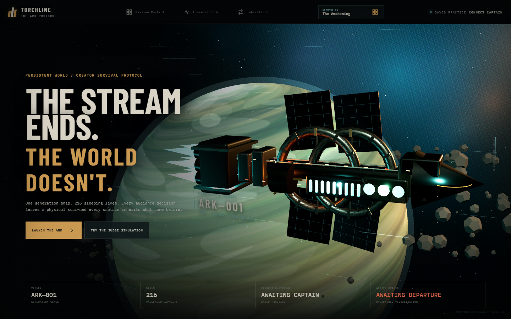
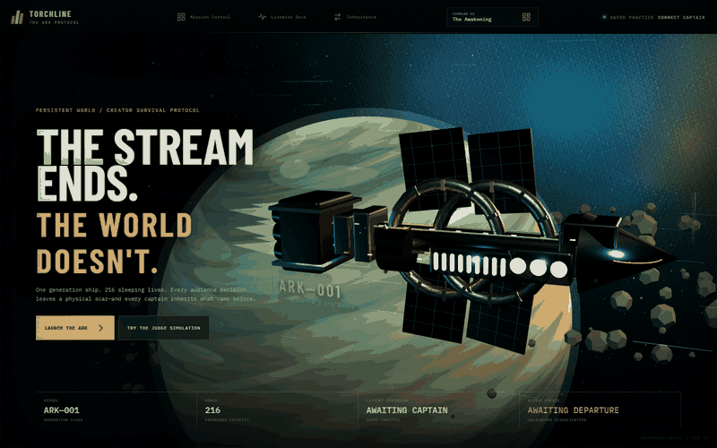
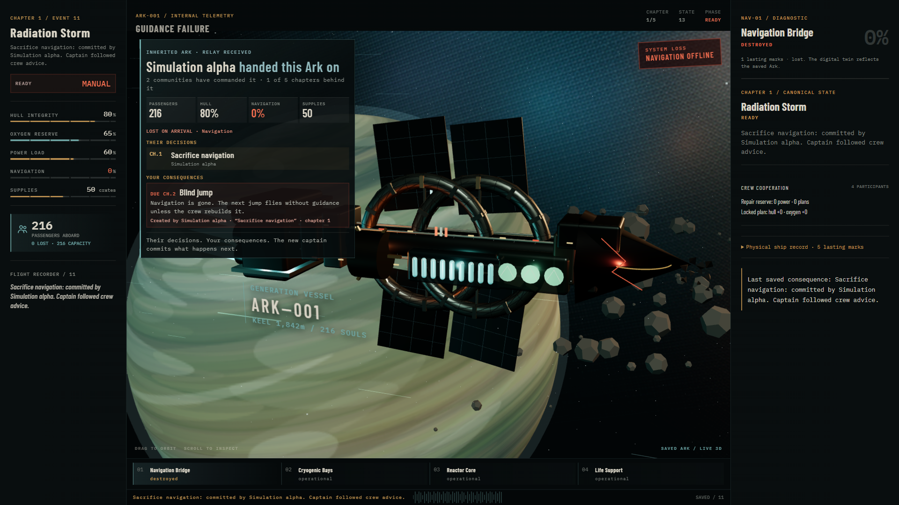
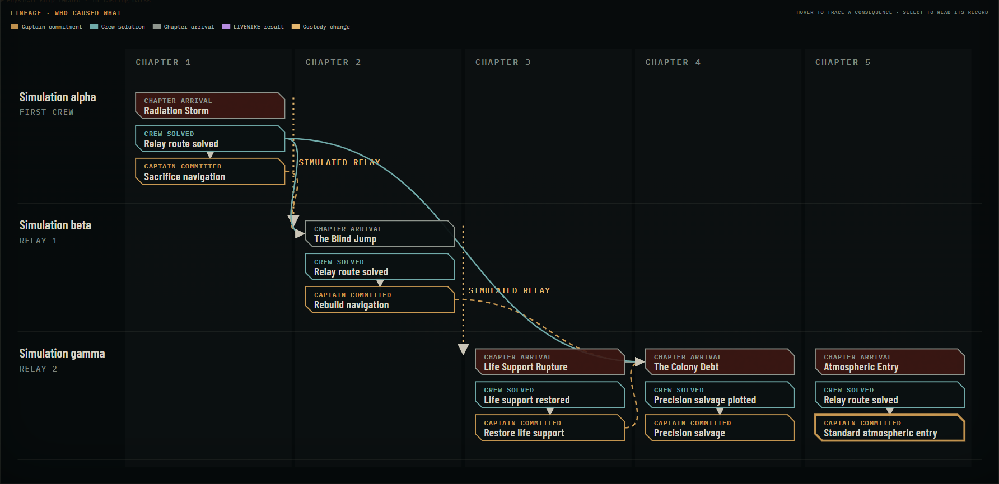
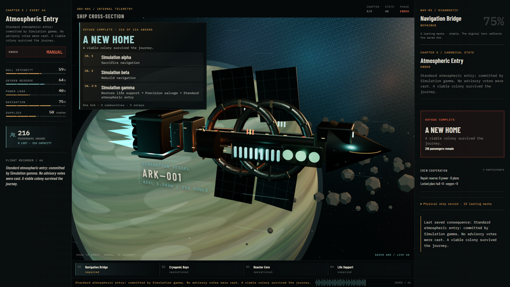
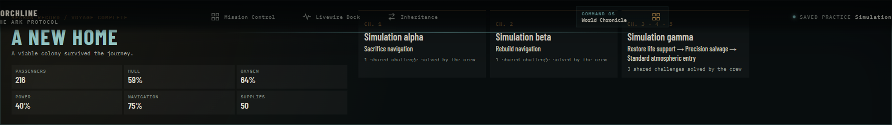
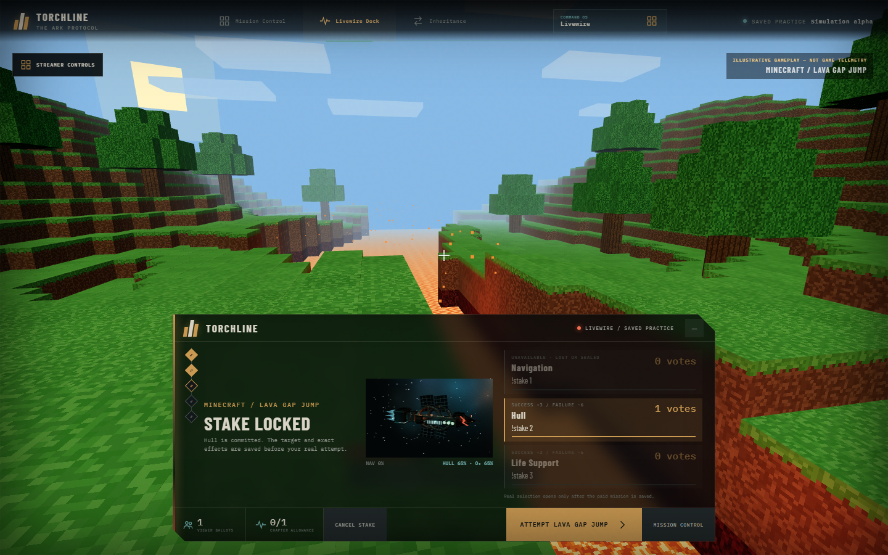
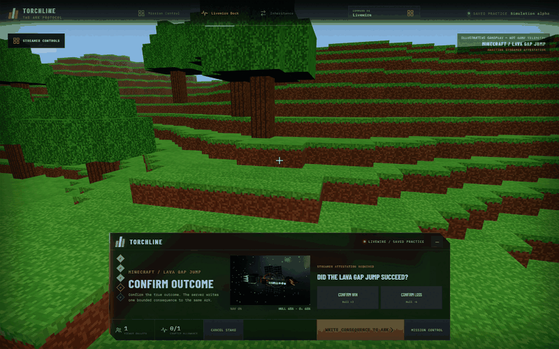
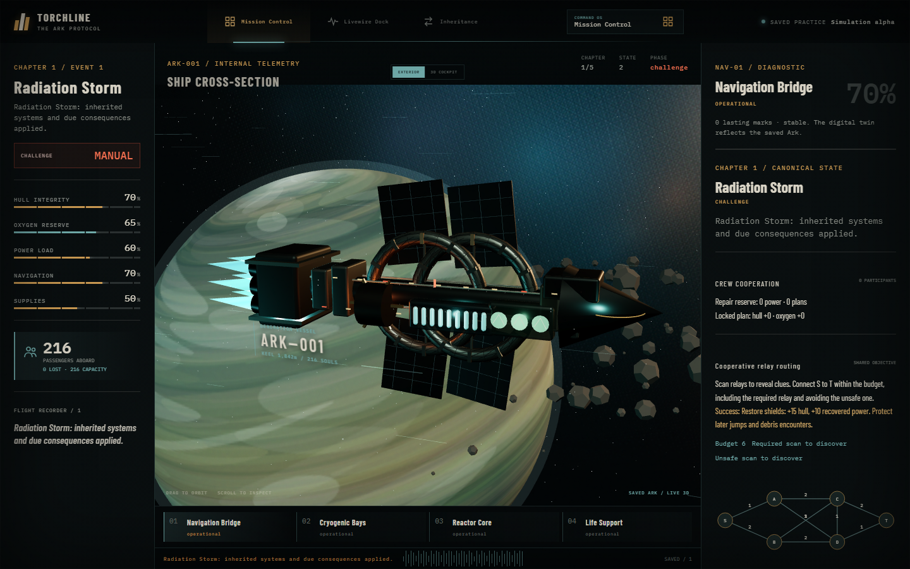
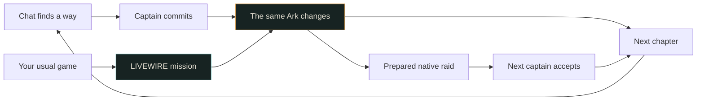

<p align="center"><strong>TORCHLINE</strong> · THE ARK PROTOCOL</p>
<p align="center"><strong>The stream ends. The world doesn't.</strong></p>

<a href="assets/readme/awakening.png"></a>

<p align="center"><a href="#a-stream-that-leaves-something-behind">The idea</a> · <a href="#one-crews-choice-becomes-the-next-crews-crisis">The relay</a> · <a href="#livewire--your-next-attempt-matters">Minecraft LIVEWIRE</a> · <a href="#try-it">Play</a> · <a href="#what-is-proven">What is proven</a> · <a href="docs/README.md">Docs</a></p>

<p align="center"><a href="docs/releases/v0.1.0-preview.2.md">v0.1.0-preview.2</a> · Development preview · Built with Codex for the Codex x TwitchCon Hackathon</p>

## A stream that leaves something behind

**A shared survival game that remembers its community.** Your audience is aboard a ship carrying 216 people. Viewers uncover clues, solve emergencies and choose where to help. The captain makes the hard calls. Every repair, sacrifice and mistake stays with that same Ark.

Play all five chapters on one channel. Or prepare a handoff and perform a genuine Twitch raid: the next captain inherits your passengers, damaged systems and unfinished story. **A raid moves the world. It isn't required to enjoy it.**

<picture>
  <source media="(prefers-reduced-motion: reduce)" srcset="assets/readme/awakening.png">
  
</picture>

<sub>Recorded from the integrated app. [Full-size still](assets/readme/awakening.png) · [SVG animation container](assets/readme/ark-roll.svg) · [Capture and provenance](assets/readme/README.md).</sub>

## One crew's choice becomes the next crew's crisis

<a href="assets/readme/relay-broadcast.png"></a>

When a captain hands the Ark on, the receiving stream sees an **inheritance dossier** over the ship: who handed it over, every decision aboard and the community that made it, the systems already lost, and each debt still waiting, linked to the decision that created it. Starting the next chapter makes the debt real. The new audience inherits a problem it can trace to people it has never met.

<details>
<summary><strong>⇄ Follow one Ark through three communities</strong></summary>

<a href="assets/readme/lineage.png"></a>

Rows are communities, columns are chapters. Arrows are saved cause links: a sacrifice that became a crisis, a repair that prevented a later leak. Dotted markers are custody changes. The season record names what each community decided. A captain can publish a revocable, read-only **public Chronicle link** so their community can keep following the Ark after it leaves their channel.

<a href="assets/readme/season-finale.png"></a>

<a href="assets/readme/season-record.png"></a>

Captured from the integrated app in saved practice. The relays used labeled simulated raid evidence, not native Twitch raids.

</details>

## LIVEWIRE — your next attempt matters

Keep playing your usual game. Before a difficult Minecraft jump, open one mission. Chat chooses which Ark system is at risk. Lock that commitment, make the attempt, then confirm what happened. A small repair or scar is written to the real saved ship—once.

<a href="assets/readme/minecraft-livewire.png"></a>

<details>
<summary><strong>▶ See the Minecraft mission scene move</strong></summary>

<picture>
  <source media="(prefers-reduced-motion: reduce)" srcset="assets/readme/minecraft-livewire.png">
  
</picture>

The scene illustrates the attempt; it does not read Minecraft or decide the result. Missions cost one supply, have a finite allowance and cannot resurrect a destroyed system. [Exact rules](docs/product/livewire-v0.md).

</details>

## Your chat can change who survives

<a href="assets/readme/mission-control.png"></a>

Discover a relay with `!scan A`, connect the safe route, patch failing equipment or help divide repairs. Solving the shared problem changes resources, ship condition and future choices. Voting is only one part of the job.

<details>
<summary><strong>◇ You're the captain. Save navigation—or save everyone?</strong></summary>

The storm arrives before the shield challenge is solved.

| Your commitment | What the next chapter inherits |
| --- | --- |
| Sacrifice navigation | All 216 people survive. Guidance is destroyed. You face a blind jump. |
| Seal the rear habitat | 168 people survive. Navigation remains available. The sealed habitat stays in the record. |

These are real engine results. [Inspect the generated proof](assets/readme/proof.json).

</details>

<details>
<summary><strong>One viewer. Four oxygen. A different ending.</strong></summary>

Follow the same planned captain's route twice. Without a chapter-three life-support repair, oxygen runs out before landing. With that repair, 156 passengers reach the surface with four oxygen remaining. It saves the voyage, without guaranteeing a perfect colony.

Open the [flight recorder](assets/readme/flight-log.csv) and search **patch** in GitHub's table. The record comes from deterministic engine commands and is checked by replay. It is a saved simulation, not a real audience session.

</details>



## Try it

With Node 24, pinned pnpm and PostgreSQL 17 ([development guide](docs/operations/development.md)):

```powershell
pnpm install --frozen-lockfile
pnpm db:up        # private local cluster and ignored .env (saved practice, LIVEWIRE on)
pnpm db:migrate
pnpm build
pnpm start        # http://localhost:3000
```

**The two-minute path:** open the app, choose **Command OS → Judge Arena**, then **Autoplay to the handoff**. Two practice communities play chapter one, prepare a relay, accept the Ark and stop on the inheritance dossier. Every step calls the same API as the dashboard. The raid proof is labeled simulation and can never move a live world. Then run step 8 to meet the debt and open the Chronicle lineage.

For free play choose **Launch the Ark** and use **Command OS** for all ten destinations. No Twitch messages are sent in saved practice.

For the real stream, follow the [owner setup guide](docs/operations/owner-launch-guide.md) in order: HTTPS → exact Twitch callback → broadcaster/bot consent → subscriptions → OBS → genuine chat → native raid. Keep the bot's role and every private OBS link private.

## What is proven

| Layer | Honest status |
| --- | --- |
| Saved survival + LIVEWIRE | Implemented with actual PostgreSQL, deterministic consequences, replay and automated tests |
| Relay rehearsal, inheritance dossier, lineage | Implemented. A browser journey runs the full two-community practice relay and checks the saved custody, scars, debt and lineage. The raid evidence there is simulated and labeled |
| Final design + OBS | Ten screens integrated; browser checks and native full/dock rendering, refresh and rotation pass in saved practice. [Evidence and limits](docs/reports/2026-10-30-final-frontend.md) |
| Twitch | Real consent, signed callbacks and incoming query chat observed; genuine chat changing the Ark still needs acceptance |
| Bot replies | Provider accepted sends; other viewers did not see them. Replies are optional and independently paused |
| Native raid + permanent hosting | Still open. Simulation does not satisfy either gate |

This is a development preview, not a production-ready claim. The final design, LIVEWIRE and recovery work share one reviewed source baseline; deployment and real Twitch acceptance remain separate. [Consolidation record](docs/reports/2026-10-30-main-consolidation.md) · [Critical audit](docs/reviews/2026-10-29-comprehensive-audit.md) · [LIVEWIRE acceptance](docs/operations/livewire-v0.md).

<details>
<summary><strong>For builders and judges</strong></summary>

React and TypeScript present the world. A pure engine decides consequences. PostgreSQL saves state, history and custody together. Twitch supplies signed input; a read-only stream updates the dashboard and OBS. Animations and bot replies never decide game outcomes.

```powershell
pnpm test
pnpm test:browser
pnpm audit:balance
pnpm design:fixtures
pnpm readme:proof
pnpm check:repo
```

[Requirements](docs/product/requirements.md) · [Architecture](docs/architecture/system-design.md) · [Decisions](docs/decisions/README.md) · [Twitch research](docs/research/twitch-integration.md) · [Changelog](CHANGELOG.md) · [Security](SECURITY.md).

The creator supplied the vision and final design direction. Codex helped research, implement and verify the system. The owner-supplied Figma v2 design supplies the final visual experience. [Asset provenance](assets/design-provenance.md).

</details>
