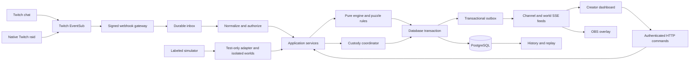

# System architecture

Status: approved architecture with a working first slice, 2026-10-26. Core gameplay, persistence, browser delivery and isolated custody are implemented and locally tested; production throughput remains unverified. Status as of 2 November 2026: real broadcaster and bot consent and signed EventSub callbacks are verified, and on 30 October 2026 three genuine viewer chat messages arrived as signed `channel.chat.message` notifications and were saved as `scan` gameplay events on a live Ark. Native OBS 32.2.2 rendered the 30 Oct final-design build in isolated saved practice; the current build is not re-verified in OBS. Verified on 2 November 2026: an overlay update from live chat on video (commands typed in the broadcaster's own chat), visible bot replies ([ADR 0040](../decisions/0040-bot-moderator-role.md)) and a live attested LIVEWIRE result. A native raid between two broadcasters and permanent hosting remain unverified. See [implementation status](../planning/implementation-status.md) and [decision stress review](decision-stress-review.md).

## Three separate responsibilities

1. **Persistent game:** deterministic chapters, puzzles, audience actions, resources, consequences and history. It has no Twitch or raid dependency.
2. **Hosted episode:** associates a world's active play with one creator/channel and translates input into domain commands. Single-channel play supports the complete season, park/resume, failure and new worlds.
3. **World custody:** controls who can operate a world. The live transfer policy requires a verified Twitch raid plus explicit source intent and recipient acceptance. Transfer is optional and never advances chapters by itself.

This separation preserves the full game when nobody raids, permits independent handoff testing, and leaves room for future collaboration surfaces without embedding Twitch payloads in game rules.

## Deployment and flow

These are modules inside one long-running Node service, plus a static React build served from the same origin. PostgreSQL is the authoritative persistence and durable work store. The inbox worker, deadline scheduler and outbox dispatcher begin in the same process; their jobs survive restarts. No Redis, distributed queue, separate microservices, Kubernetes, or serverless timer assumptions are necessary initially.

## Module boundaries

| Component | Owns | Must not own |
| --- | --- | --- |
| Identity | OAuth grants, server sessions, creator consent | Game resources or custody decisions |
| Twitch gateway/adapter | Raw-byte authentication, subscriptions, payload normalization | Unilateral world transfer or invented raid proof |
| Participation | Command grammar, account/phase eligibility, deduplication, tallies | Direct resource writes |
| Engine/content | State transitions, puzzles, rules, consequences, deterministic replay | Database, clocks, Twitch types, network, runtime AI |
| Episode service | Active host, phase windows, deadlines, pause/resume | Implicit ownership grants |
| Custody coordinator | Intent, raid evidence, consent, atomic assignment | Advancing the game chapter |
| Storage/work | Transactions, constraints, inbox, outbox, timer jobs | Trusting client-provided authorization |
| Read models/live feeds | Sanitized snapshots, tally summaries, channel assignment changes | Client authority over canonical state |
| Browser surfaces | Presentation, local animation, HTTP interactions | Rules execution that changes persisted state |
| Simulator/replay | Controlled input, reference fixtures, reconstruction | Live evidence generation or mutation of live worlds |

## Command processing and consistency

Accept a domain command only after resolving the authenticated actor, mode, channel/world association, current custody and expected version. Reject stale browser decisions with a conflict response and fresh snapshot. Chat has no client version; resolve its eligible window from persisted phase intervals and the signed notification timestamp, bounded by server receipt. Use `receivedAt` as the authoritative cutoff, with notification time rejecting pre-window messages. This cannot establish a perfect Twitch send timestamp; the latency policy must be explained to players.

For world mutations: begin a transaction, lock the relevant channel rows in sorted ID order, then world and handoff rows in a fixed order, recheck authorization/phase, evaluate the pure transition, append domain events, update snapshot/version and outbox records, commit. External API calls and animations run outside the transaction. Every operation touching these rows follows the same lock order. PostgreSQL constraints remain the final guard against double assignment. Use bounded retries for deadlocks and serialization failures.

Participation writes use a unique `(world, decision, actor)` entry and immutable accepted action sequence. A newer eligible vote replaces the previous tally contribution. Distinguish delivery deduplication, chat-message deduplication and command idempotency. For recognized commands, durable ingress briefly locks the active phase row, checks its database receipt-time cutoff, binds the window and assigns its input sequence. Closing takes the same lock, marks `CLOSING`, records an input-sequence watermark, and drains all accepted inbox items through that watermark before finalizing the summary once. Worker delay must not discard an input durably accepted before close. New input cannot enter a closing window. Do not serialize all chat on the entire world snapshot row. This is important when a busy community participates while another world is active.

## Native raid handoff protocol

1. Source selects an opted-in, connected destination. Check target readiness, active slot and current subscription health. A world must be at a chapter boundary; finish or cancel an in-progress interaction first.
2. Persist one pending intent for this world, source, destination and frozen version. Freeze mutation with a visible handoff state. Proposed intent lifetime: three minutes, adjustable after live testing. This is a product choice, not a Twitch guarantee.
3. Source performs the native raid in Twitch. TORCHLINE does not request raid-management scopes or initiate it.
4. The gateway receives a signed `channel.raid` notification on the destination's inbound subscription. Durably record it and match source/destination, mode, pending intent, receipt interval and transport timestamp. Bind this proof to one intent and mark it `VERIFIED`.
5. Receiver sees the exact world, resources, originating creator, proof status and expiry. Accept is enabled only after verification. A readiness toggle or earlier preview is not final consent.
6. Acceptance locks both channel rows, world and intent. Recheck live consent, source custody, frozen version, empty destination slot, freshness and unused proof. Atomically remove the source's active slot, insert the destination slot, update custody/version, append the transfer event, complete the intent and publish intents for both channels.
7. After commit, source controls lose authority and source overlay clears its active world. Destination's channel-bound overlay displays the same world and an arrival recap. Chapter progression waits for the receiver to start the next chapter.

State machine: `PREPARED -> VERIFIED -> COMMITTED`; `PREPARED` or `VERIFIED` can become `CANCELLED`, `DECLINED`, `EXPIRED` or `FAILED`. Duplicate accept returns the original result. A proof cannot be reused for another intent. Recipient opt-out, target occupancy changes or stale versions prevent commit. On failure, custody stays with the source; unfreeze only through an authorized transition. Offline source status alone does not invalidate a prepared transfer, because raiding commonly accompanies ending a broadcast.

Twitch's raid event has no application nonce, participant roster, or dedicated occurrence timestamp/raid ID. A bounded intent window and one canonical inbound subscription reduce ambiguity; they do not create cryptographic correlation with the broadcaster's exact button click. Disallow overlapping source intents and require a ten-minute same-pair cooldown after cancellation/expiry before rearming, initially matching the webhook freshness horizon. Track accepted proof IDs and surface delayed/ambiguous events for retry, never manufacture proof. Finalize timing after observing genuine events. Platform semantics and limits are documented in [the integration research](../research/twitch-integration.md).

## Live browser delivery

Use authenticated HTTP for all commands and **server-sent events (SSE)** for read-only updates. The current clients need server-to-browser state, not continuous bidirectional gameplay input. Native EventSource reconnection avoids a custom socket command protocol. The [HTML standard](https://html.spec.whatwg.org/multipage/server-sent-events.html) defines the mechanism; actual hosting/OBS compatibility must pass the deployment smoke test.

Publish versioned complete presentation snapshots, coalescing tally changes to at most five per second per active world. Clients ignore older revisions and refetch after gaps. A channel-level sequence also covers assignment changes when its active world changes. Reconnect always receives the current snapshot; missed animations are not replayed as new gameplay. Send heartbeat comments, disable stream buffering/compression on this route, bound slow-client queues and disconnect slow readers. The outbox prevents a committed change from disappearing before a publish attempt; it does not guarantee that every browser saw it.

The creator uses the server session. OBS exchanges a channel-scoped read capability from its URL fragment for a narrowly scoped, revocable overlay session, then opens its feed. Never put Twitch tokens or capabilities in query logs. Test multiple overlay sources, browser tabs, proxy idle timeouts and HTTP connection limits. If streaming is buffered or OBS behaves unreliably, use the same read-model contract over WebSocket; this is a transport change, not a game rewrite.

## Recovery and isolation

Persist deadlines and pause state. A startup reconciliation job closes overdue interaction windows idempotently, but never silently commits a creator's choice. If downtime overlaps an active timed interaction, pause and require explicit resume into a new window, keeping accepted contributions visible. An expired handoff is cancelled safely without changing custody. Unprocessed inbox/outbox work is claimed with leases and retried; poison messages go to an operator-visible failed state.

Loss of Twitch chat subscription pauses audience interaction and shows connection status. Stream offline events are advisory signals and can be late; use them to pause a hosted episode, not erase a world. Database unavailability means no gameplay acknowledgement or custody commit. Browser disconnection does not mutate gameplay. A creator can explicitly park a world to release its active slot; the same custodian can resume later.

Live and simulated worlds use separate databases/deployments where practical, mandatory mode fields in all identities, commands and evidence, and server-side rejection of simulated proof for live custody. The live service has no public event-injection endpoint. Historical replay is read only.

## Scaling and later collaboration

Independent worlds do not share game locks. Begin with one application replica; correctness still uses database constraints, not in-memory ownership. Before a second replica, provide database-backed cross-process notification or per-instance durable outbox fan-out, shared sessions/rate limits, worker leases and single-owner subscription reconciliation. A one-consumer outbox alone does not notify clients connected to another replica.

Broader collaboration can add opt-in recipient discovery, scheduled relay readiness, spectators and delegated cohost roles using the identity/custody boundary. Later non-raid transfers, if desired, must be an explicitly separate policy with consent and audit rules. Raid authenticity remains the signature path; a live native raid has not yet been demonstrated (the Judge Arena uses labelled simulated proof).
